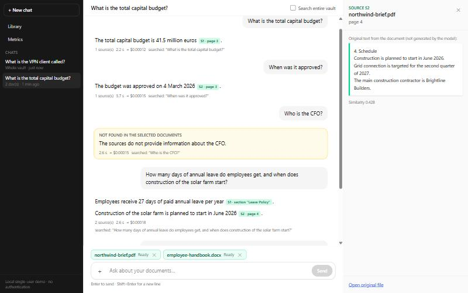

# AI Vault: chat with your documents, with verified citations

A backend for "ChatGPT for your documents". Upload PDF, DOCX, TXT or Markdown files; a background
pipeline extracts the text with page or section locations, indexes it for hybrid retrieval and
generates AI insights; then you chat with one or more documents and get **streamed answers whose
citations are checked by the server** (document, page/section, original excerpt), or an explicit
"not found".



*Real mode (`gpt-4o-mini`), from the demo dry run: cited answers with page/section chips, an
amber "not found", a two-document answer, and the source panel showing page 4's original text.*

> **Status (2026-10-15):** backend and ChatGPT-style UI complete, plus custom summaries,
> comparisons, document versions and rate limiting; 142 fake-mode backend tests.
> Three approved real-model runs:
> - a 10-question smoke test: 10/10 (7 cited answers on the right page, 3 correct "not found");
> - a demo dry run through the UI: six questions, including a two-document answer, whole-vault
>   search and Stop;
> - a re-test of the follow-up rewrite prompt (`chat.condense.v2`). It fixed "When was it
>   approved?" but mis-resolved "its" when the conversation never named the referent.
>
> Estimated AI spend so far: $0.0044. See [docs/EVALUATION.md](docs/EVALUATION.md) for the
> results and for what they do **not** show; retrieval at scale is untested.
> Local, single-user demo with **no authentication**: not a secure or multi-user vault.

## 1. Features mapped to the brief

| Brief item | Status | Where |
|---|---|---|
| RAG document chat with source citations (REQ, core) | Done (fake-mode tests + one live smoke test, 10/10) | `services/chat.py`, `services/citations.py` |
| Intelligent upload handler (REQ) | Done: byte sniffing, limits, SHA-256 dedupe, per-file outcomes | `services/upload.py` |
| Smart document analysis (REQ) | Done: summaries, key points with source pages, entities, topics, category, tags, sentiment, suggested questions | `services/insights.py` |
| Asynchronous pipeline (REQ) | Done: Celery extract → index ‖ insights, retries, idempotent stages | `services/pipeline.py`, `workers/` |
| Upload / retrieval / insights APIs (REQ) | Done | `api/documents.py` |
| Start session / ask / history / multi-turn (REQ) | Done (follow-ups condensed with the last 6 messages) | `api/chat.py` |
| Document statistics / processing metrics APIs (REQ) | Done | `api/metrics.py` |
| Data storage for all listed entities (REQ) | Done | `models/__init__.py`, Alembic `0001` |
| LangChain, embeddings, auto API docs, pytest (REC) | Done | Swagger at `/docs` |
| Frontend (OPT/BONUS) | Done: ChatGPT-style React UI (sessions, multi-file drag-and-drop with live status chips, streamed cited answers + source panel, library with insights, metrics) | `frontend/` |
| Streaming (OPT/BONUS) | Done: SSE chat tokens | `POST …/messages/stream` |
| Caching (OPT/BONUS) | Done: query embeddings, metrics; answers deliberately not cached | `services/cache.py` |
| Multi-document chat, follow-up suggestions, categorisation/tagging, sentiment/key insights (BONUS) | Done | |
| pgvector, real-time updates, test coverage (BONUS) | Done: pgvector HNSW + exact scan, SSE status stream, 126 backend tests | |
| Cost tracking, logging/observability, health checks (BONUS) | Done: `ai_calls` ledger + spend cap, JSON logs with request IDs, `/health/ready` | |
| Summary customisation: length, focus, tone (BONUS) | Done (fake-mode tests and UI check); real-model output **NOT VERIFIED** | `services/summaries.py`, `POST /documents/{id}/summaries` |
| Comparative analysis between documents (BONUS) | Done (2–4 documents or versions; cited similarities and differences); real-model output **NOT VERIFIED** | `services/comparisons.py`, `POST /comparisons` |
| Rate limiting and quota management (BONUS) | Done: per-client limits in Redis (`429 RATE_LIMITED` + `Retry-After`) next to the spend cap | `core/ratelimit.py` |
| Document version tracking (BONUS) | Done: new versions keep history; vault-wide chat uses the latest | `POST /documents/{id}/versions` |

## 2. Quickstart

Prerequisites: Docker Desktop (or Docker Engine + Compose v2). Nothing else is needed on the host.

```bash
cp .env.example .env
```

Edit `.env`:
- either set `OPENAI_API_KEY=sk-...` (keep it on its own line, no comment after it),
- or set `AI_PROVIDER=fake` to run without a key (deterministic test doubles, clearly labelled
  "FAKE AI MODE"; useful to try the plumbing, not AI quality).

```bash
docker compose up --build
```

- **Web UI: http://localhost:5173** (the `web` container serves the production build and
  proxies `/api` to the API)
- API + Swagger UI: http://localhost:8000/docs (OpenAPI JSON at `/api/v1/openapi.json`)
- Readiness: http://localhost:8000/api/v1/health/ready
- Migrations run automatically when the API container starts.

Stop with `docker compose down` (add `-v` to delete the database and stored files).

## 3. Configuration

| Variable | Default | Meaning |
|---|---|---|
| `AI_PROVIDER` | `openai` | `openai` or `fake` (deterministic doubles; every record gets `model="fake"`, responses say `ai_mode: fake`) |
| `OPENAI_API_KEY` | — | Only in `.env`, never committed. Without it in `openai` mode the API starts, AI stages fail with `AI_NOT_CONFIGURED`, `/health/ready` reports it |
| `OPENAI_CHAT_MODEL` | `gpt-4o-mini` | Chat/insights model (must have a price in `app/ai/pricing.py`) |
| `OPENAI_EMBEDDING_MODEL` | `text-embedding-3-small` | Embedding model |
| `EMBEDDING_DIMENSIONS` | `1536` | Must match the `vector(1536)` column |
| `AI_SPEND_LIMIT_USD` | `0.50` | Hard cap on estimated spend, checked before every AI call |
| `AI_MAX_RETRIES` | `3` | Bounded retries for transient AI errors |
| `DATABASE_URL` | `postgresql+psycopg://vault:vault@db:5432/vault` | Postgres (psycopg 3) |
| `REDIS_URL` / `CACHE_REDIS_URL` | `redis://redis:6379/0` / `/1` | Celery broker / caches, pub/sub, heartbeat |
| `STORAGE_DIR` | `/data/storage` | Original files (Docker volume) |
| `WORKER_CONCURRENCY` | `2` | Celery worker processes |
| `CORS_ORIGINS` | `http://localhost:5173` | Allowed browser origins |
| `LOG_LEVEL` | `INFO` | JSON logs |
| `MAX_UPLOAD_MB` / `MAX_PAGES` / `MAX_FILES_PER_UPLOAD` | `25` / `300` / `10` | Upload limits |
| `CHUNK_TOKENS` / `CHUNK_OVERLAP_TOKENS` | `800` / `100` | Chunking (cl100k tokens) |
| `RETRIEVAL_TOP_K` | `8` | Sources given to the model |
| `INSIGHTS_SINGLE_PASS_MAX_TOKENS` | `60000` | Above this, insights use map-reduce |
| `ON_DEMAND_MAX_INPUT_TOKENS` | `40000` | Input cap for custom summaries; comparisons split it across their documents. Longer documents are sent in selected parts (`coverage.complete: false`) |
| `RATE_LIMIT_ENABLED` | `true` | Per-client rate limits (fixed one-minute windows in Redis) |
| `RATE_LIMIT_AI_PER_MINUTE` / `RATE_LIMIT_UPLOAD_PER_MINUTE` | `20` / `30` | `ai`: questions, custom summaries, comparisons · `upload`: uploads, new versions, reprocess. `0` = no limit |
| `RUN_LIVE_AI_TESTS` | `0` | Live tests run only when `1` (and approved) |
| `DEBUG_PROMPTS` | `0` | Reserved dev flag, currently unused: prompts and document text are never logged |

## 4. API walkthrough (curl)

The same steps are scripted in [`scripts/walkthrough.sh`](scripts/walkthrough.sh)
(`bash scripts/walkthrough.sh`). Sample files are in [`samples/`](samples/).

```bash
API=http://localhost:8000/api/v1

# 1. Upload 3 files: a PDF, the same PDF again (duplicate) and a renamed binary (invalid)
curl -X POST $API/documents \
  -F "files=@samples/northwind-brief.pdf" \
  -F "files=@samples/northwind-brief.pdf;filename=northwind-brief-copy.pdf" \
  -F "files=@samples/not-a-document.exe;filename=report.pdf"
# → 202 {"results":[{"outcome":"accepted",...},{"outcome":"duplicate","duplicate":true,...},
#        {"outcome":"rejected","error":{"code":"UNSUPPORTED_FILE_TYPE",...}}], ...}
DOC=<document id from the first result>

# 2. Watch status live (SSE); ends when the document is no longer processing
curl -N "$API/documents/events?ids=$DOC&close_when_settled=true"
curl $API/documents/$DOC                      # stages, chat_ready, counts, warnings, last error

# 3. Insights
curl $API/documents/$DOC/insights

# 4. Ask a cited question
SESSION=$(curl -s -X POST $API/chat/sessions -H 'Content-Type: application/json' \
  -d "{\"document_ids\":[\"$DOC\"]}" | python -c "import sys,json;print(json.load(sys.stdin)['id'])")
curl -X POST $API/chat/sessions/$SESSION/messages -H 'Content-Type: application/json' \
  -d '{"content":"What is the total capital budget?"}'

# 5. Follow-up, streamed (meta → token… → citations → done)
curl -N -X POST $API/chat/sessions/$SESSION/messages/stream -H 'Content-Type: application/json' \
  -d '{"content":"When was it approved?"}'

# 6. A question the document cannot answer → answer_status "not_found"
curl -X POST $API/chat/sessions/$SESSION/messages -H 'Content-Type: application/json' \
  -d '{"content":"Who is the CFO?"}'

# 7. Custom summary: length short|medium|long, tone neutral|executive|technical|plain, optional focus
curl -X POST $API/documents/$DOC/summaries -H 'Content-Type: application/json' \
  -d '{"length":"short","tone":"executive","focus":"budget and risks"}'

# 8. Upload a revised file as version 2, then compare the two versions
NEW=$(curl -s -X POST $API/documents/$DOC/versions -F "file=@samples/northwind-brief-v2.pdf" \
  | python -c "import sys,json;print(json.load(sys.stdin)['id'])")
curl $API/documents/$DOC/versions
curl -X POST $API/comparisons -H 'Content-Type: application/json' \
  -d "{\"document_ids\":[\"$DOC\",\"$NEW\"]}"

# 9. History and metrics
curl "$API/chat/sessions/$SESSION/messages?limit=20"
curl $API/metrics/documents
curl "$API/metrics/processing?window=24h"
```

### Endpoints (prefix `/api/v1`)

| Endpoint | Purpose |
|---|---|
| `POST /documents` | Upload 1–10 files (`files`); per-file `accepted` / `duplicate` / `rejected`; 202 unless every file is rejected |
| `GET /documents` | List (newest first, latest versions only unless `all_versions=true`); filters `status`, `q` (filename), `category`; `limit`/`offset` |
| `GET /documents/{id}` | Detail: stage statuses, `chat_ready`, counts, warnings, last error |
| `GET /documents/{id}/content` | Extracted original text by page/section with locators (paginated) |
| `GET /documents/{id}/file` | Original file |
| `GET /documents/{id}/insights` | AI insights; `404 INSIGHTS_NOT_READY` with current status |
| `POST /documents/{id}/versions` | Upload one file (`file`) as the next version; `409 VERSION_UNCHANGED` / `DUPLICATE_CONTENT` for identical files |
| `GET /documents/{id}/versions` | All versions of the document, newest first |
| `POST /documents/{id}/summaries` | Custom summary (`length`, `tone`, `focus`); identical options return the stored result (`cached: true`, no AI cost) |
| `GET /documents/{id}/summaries` | Custom summaries generated for the document |
| `POST /comparisons` | Compare 2–4 documents (`document_ids`, optional `focus`): overview, similarities, differences, each cited; stored and reused |
| `GET /comparisons?document_id=`, `GET /comparisons/{id}` | Past comparisons |
| `POST /documents/{id}/reprocess?stages=` | Re-run failed (default) or chosen stages; `409` while processing |
| `DELETE /documents/{id}` | Delete this version: file, segments, chunks, insights, custom summaries, comparisons that include it, cached metrics; old citations keep their snapshot; the newest remaining version becomes the latest |
| `GET /documents/events?ids=` | SSE: snapshot, then live status; `: ping` every 15 s |
| `POST/GET /chat/sessions`, `GET/PATCH/DELETE /chat/sessions/{id}` | Sessions: scope = documents or whole vault (`scope_mode: all`) |
| `POST /chat/sessions/{id}/messages` | Ask; complete JSON answer with citations |
| `POST /chat/sessions/{id}/messages/stream` | Ask; SSE `meta`, `token`…, `citations`, `done` / `error`; disconnect saves the partial answer (`interrupted`) |
| `GET /chat/sessions/{id}/messages` | History (oldest first) with citations and usage |
| `GET /metrics/documents`, `GET /metrics/processing?window=1h\|24h\|7d\|all` | Monitoring (every rate with numerator and denominator) |
| `GET /health`, `GET /health/ready` | Liveness; DB, Redis, worker heartbeat, AI configuration |

Errors always look like `{"error": {"code", "message", "details"}, "request_id"}` and every
response carries `X-Request-ID`. Codes: `UNSUPPORTED_FILE_TYPE` 415, `EMPTY_FILE` 400,
`FILE_TOO_LARGE` 413, `TOO_MANY_FILES` 400, `UPLOAD_REJECTED` 400 (all files rejected for mixed
reasons), `VALIDATION_ERROR` 422, `NOT_FOUND` 404, `INSIGHTS_NOT_READY` 404,
`DOCUMENTS_NOT_READY` 409, `NO_DOCUMENTS_IN_SCOPE` 422, `DOCUMENT_PROCESSING` /
`NOTHING_TO_REPROCESS` / `EXTRACTION_REQUIRED` / `DOCUMENT_NOT_EXTRACTED` / `VERSION_UNCHANGED` /
`DUPLICATE_CONTENT` 409, `RATE_LIMITED` 429 (with `Retry-After` and `X-RateLimit-*` headers),
`AI_BUDGET_EXCEEDED` 429,
`AI_PROVIDER_UNAVAILABLE` 503, `AI_NOT_CONFIGURED` 503. Stage failure codes on documents:
`ENCRYPTED_DOCUMENT`, `CORRUPT_DOCUMENT`, `PAGE_LIMIT_EXCEEDED`, `NO_EXTRACTABLE_TEXT`,
`UNSUPPORTED_ENCODING`, `AI_PROVIDER_UNAVAILABLE`, `AI_BUDGET_EXCEEDED`, `AI_QUOTA_EXCEEDED`,
`AI_AUTH_FAILED`, `STAGE_TIMEOUT`, `QUEUE_UNAVAILABLE`, `WORKER_LOST`, `INTERNAL_ERROR`.

## 5. Architecture and data flow

```
client ──REST──▶ FastAPI ──enqueue──▶ Redis broker ──▶ Celery worker (Linux container) ──▶ OpenAI
   ▲  ◀──SSE (tokens, doc status)── │                        │
   │                                ├── PostgreSQL + pgvector (source of truth) ◀──┘
   │                                └── Redis pub/sub doc:{id} ◀── worker publishes
   └─────────────────────────────────── local file volume (Storage interface)
```

**Ingestion.** Upload streams each file to a temp file while hashing and size-checking, sniffs
the type from the bytes, dedupes by SHA-256, stores `storage/{id}/original.{ext}`, commits the row
(`queued`) and only then enqueues `extract`. Extract writes segments with truthful locators (PDF:
physical page; DOCX/MD: heading section; TXT: line range) and enqueues **index** and **insights**
as independent tasks. Index splits each segment on its own (chunks never cross a page/section, so
every chunk has an exact locator), embeds in batches ≤ 100 and replaces the document's chunks in
one transaction. Every stage writes a `processing_runs` row and publishes a status event.

**Readiness.** `chat_ready = index succeeded`. Insights are not needed for chat and vice versa.
Derived status: `queued` (nothing started), `processing` (any stage pending/running/retrying),
`ready` (index and insights succeeded), `partial` (one of them failed: chat still works if index
succeeded), `failed` (extraction failed, or both failed).

**Questions.** Validate scope (`409 DOCUMENTS_NOT_READY` lists documents) → store the user
message → condense the follow-up with the last 6 messages (only when history exists) → embed the
query (cached) → hybrid retrieval inside the scope → prompt with `[S1]…[Sn]` sources → generate
(streamed or not) → validate citations on the server → store the answer, citations (snapshots),
retrieval trace, latencies and ledger rows.

**Reliability.** `task_acks_late`, `task_reject_on_worker_lost`, prefetch 1, Redis visibility
timeout 3600 s (> longest hard limit); soft/hard limits extract 120/150 s, index and insights
300/360 s; only transient errors (OpenAI timeout/429/5xx, DB connection) retried with exponential
backoff + jitter; stages are idempotent and claim the row under `SELECT … FOR UPDATE`, so a
re-delivered task can't move a document backwards; runs left by a dead worker are closed as
`WORKER_LOST`. Separate `ingest` and `ai` queues.

## 6. Data model

`documents` (status per stage, counts, warnings, errors, timestamps; `version_group_id`,
`version`, `is_latest`, with a partial unique index allowing one latest per group) · `document_segments`
(page/section text with locator and offsets) · `chunks` (text, locator, `vector(1536)`,
generated `tsvector`; HNSW cosine, GIN, btree on document) · `document_insights` (unique per
document + prompt version, with coverage) · `document_summaries` (custom summaries, unique per
document + options + prompt version + model) · `document_comparisons` (result JSON, document
snapshot, GIN index on `document_ids`) · `processing_runs` · `chat_sessions` +
`chat_session_documents` · `messages` (answer status, standalone query, scope used, retrieval
trace, latencies) · `message_citations` (snapshot of document name, locator, excerpt; chunk and
document FKs set NULL on delete) · `ai_calls` (ledger; no FKs so spend survives deletions).

## 7. Design decisions and assumptions

- **[ASSUMPTION]** PDF (with a text layer), DOCX, TXT, MD; ≤ 25 MB, ≤ 300 pages, ≤ 10 files per
  request; English. No OCR: scanned PDFs fail with `NO_EXTRACTABLE_TEXT` and a message saying so.
- **[ASSUMPTION]** Single user, no auth, local Docker only.
- **PDF page numbers** are physical page indexes (1-based), not printed labels. **DOCX has no
  reliable pages**, so its citations use section heading + index, never invented page numbers.
- **Retrieval SQL is our own** (not LangChain's PGVector store): it lets us enforce the scope
  filter, exact scans and hybrid fusion. LangChain is used for model wrappers, structured output,
  prompt templates and the token splitter.
- **SSE, not WebSocket.** Both chat tokens and document status flow one way (server → browser);
  the question goes up as a normal POST and "stop generating" is just closing the stream. SSE runs
  over plain HTTP, gives the same live experience as the brief's WebSocket bonus, and needs no
  extra protocol. FastAPI 0.143's native `EventSourceResponse` is used (no `sse-starlette`).
- **Chat answers are never cached**: the same words in another session can mean something else
  (different scope and history), and a reused answer could cite out-of-scope documents. Query
  embeddings and metrics are cached; duplicate files are deduplicated.
- Duplicate uploads return the existing document (`duplicate: true`) without reprocessing, even if
  that document had failed (use reprocess).
- **Versions are explicit** (`POST /documents/{id}/versions`), never guessed from a matching
  filename: two unrelated "report.pdf" files are common. The old version keeps its chunks,
  insights and citations. Vault-wide chat and the default list use only the latest version; a chat
  attached to an old version keeps it (its answers stay reproducible), and its chip says that a
  newer version exists. Version numbers are max(remaining) + 1, so the number of a deleted newest
  version can be reused.
- **Custom summaries and comparisons are synchronous** (a few seconds expected with
  `gpt-4o-mini`; not measured) and stored: an identical request returns the stored result with
  `cached: true` and no AI cost. This is safe, unlike caching chat answers, because the input is
  fully determined by the document(s) and the options. Long inputs are cut to
  `ON_DEMAND_MAX_INPUT_TOKENS`: the parts sharing words with the focus first (otherwise evenly
  spread parts), and `coverage` says what was included.
- **Comparison output is validated like citations**: every cited (document, page/section) must
  exist in what the prompt contained; a similarity needs sources in two documents; a position
  without a valid source is shown as "No source was cited" rather than as the document's claim.
- **Rate limits** are per client IP in fixed one-minute windows (Redis `INCR` + `EXPIRE`), checked
  before anything is stored. `X-Forwarded-For` is ignored because it can be forged. A fixed
  window can let up to twice the limit through around a boundary, acceptable for abuse
  protection; the spend cap still bounds cost. If Redis is down, requests are allowed (logged).

## 8. RAG and prompt design (summary)

Prompts are versioned files in `backend/app/prompts/` and every stored output records its
`prompt_version`. Answers must cite `[S#]` after every factual sentence or start with
`[NO_ANSWER]`; source text is delimited and declared to be data, so instructions inside documents
are ignored. The server then removes any marker it did not provide (`unsupported` if none valid
remain) and maps valid ones to the stored chunk text. Insights use one structured call for
documents up to 60K tokens and map-reduce over ~8K-token groups above that, so the whole document
is covered; page references outside the document are dropped and counted. Retrieval fuses vector
search (exact scan within a scope, HNSW with iterative scans vault-wide) and Postgres full-text
search with reciprocal rank fusion, with per-document candidates and a soft per-document cap for
multi-document chats. Details: [docs/PROMPTS.md](docs/PROMPTS.md); architecture details: [docs/ARCHITECTURE.md](docs/ARCHITECTURE.md).

## 9. Scale (design reasoning, not measured)

Nothing below has been load-tested; it is how the design is meant to scale.
- Upload is O(file size) streaming + one insert; heavy work runs in workers that scale
  horizontally; `ingest` and `ai` queues can be scaled separately.
- Document-scoped retrieval is an exact scan over that scope's chunks (fast for thousands of
  chunks, always correct); vault-wide uses HNSW. Whether Postgres picks HNSW depends on table size;
  at the few-thousand-chunk scale tested locally it preferred the `document_id` btree (correct,
  cheaper there). **NOT VERIFIED** at large scale.
- All list endpoints are paginated and indexed. Next steps: S3 storage, cursor pagination,
  partitioned `ai_calls`, a dedicated vector store only if pgvector becomes the bottleneck.

## 10. Cost controls

Every AI call writes an `ai_calls` row (purpose, model, tokens, estimated cost, latency, status).
Prices live in `app/ai/pricing.py` (as of 2026-10-15: gpt-4o-mini $0.15/1M input, $0.075 cached,
$0.60 output; text-embedding-3-small $0.02/1M). The spend total (cached in Redis, recomputed from
the database on a miss) is checked before each call; at `AI_SPEND_LIMIT_USD` calls fail with
`AI_BUDGET_EXCEEDED` (429), without retry. The cap can be overshot by at most the calls already in
flight. Embedding tokens are counted locally with the model's tokenizer (LangChain does not
return embedding usage). **All cost figures are estimates**, not invoice amounts. Rough design
estimates (not measured): ~$0.01–0.02 per 100-page document, ~$0.001 per question.

## Web UI

`frontend/`: Vite + React 19 + TypeScript (strict) + Tailwind CSS 4 + TanStack Query +
react-markdown. API types are generated from the backend's OpenAPI schema
(`npm run gen:api` → `src/api/schema.d.ts`).

- **Chat:** sidebar with "New chat" and sessions (rename, delete); drop several files anywhere
  on the chat (or use **+**): each gets a chip with live status from the SSE status stream,
  the failure reason, "already in vault" for duplicates, and a remove button. Send stays disabled,
  with a hint, until the attached documents are chat-ready. Answers stream token by token
  (**Stop** closes the stream; the server saves the partial answer). Citation chips open a side
  panel with the document, page/section and the stored original excerpt. `not_found`,
  `unsupported` and failed answers are styled differently. An empty chat offers the attached
  documents' suggested questions. "Search entire vault" switches the session's scope.
  Enter sends, Shift+Enter adds a line.
- **Library:** all documents with status, filters, insights drawer (summary, key points with
  pages/sections, entities, tags, tone), reprocess and delete. The drawer also has a **custom
  summary** form (length, tone, focus) and a **versions** panel (upload a new version, switch
  between versions, "What changed since v1?"). Tick 2–4 documents and press **Compare** for the
  comparison page (`#/compare/<id>`): differences as a table with one column per document,
  similarities, and page chips that open the original PDF at that page. "Older versions" shows
  superseded versions.
- **Metrics:** document statistics, AI usage and estimated cost, chat rates and latency,
  per-stage processing.
- A yellow **FAKE AI MODE** banner shows whenever the backend runs with `AI_PROVIDER=fake`.
- The chat stream is a POST, which the browser's `EventSource` cannot do, so it is read from
  the `fetch` body with a small SSE parser (`src/api/sse.ts`); document status uses
  `EventSource`.

Development (hot reload, proxying to the API on :8000):

```bash
cd frontend && npm install && npm run dev      # http://localhost:5173 (stop the web container first)
npm run build                                  # strict type-check + production build
```

## 11. Testing

```bash
docker compose -f compose.test.yml run --rm tests                  # full fake-mode suite
docker compose -f compose.test.yml run --rm tests sh -c "ruff check . && ruff format --check ."
```

- **Fake-mode suite (142 tests)** runs against real Postgres + pgvector and Redis containers.
  `FakeEmbeddings` is a hashed bag-of-words (lexical similarity is real, so retrieval tests mean
  something); `FakeChatModel` is scripted. It proves the plumbing: upload rules, extraction codes
  and locators, state machine and retries, idempotency, concurrency, retrieval scope and fusion,
  citation validation, condensing, streaming and disconnects, metrics, caches, spend cap, versions,
  custom summaries and comparisons (options, caching, output validation, long-document
  selection), rate limits. It does **not** prove answer quality.
- **Live tests** (`tests/live/`, `pytest -m live`) call OpenAI and run only with
  `RUN_LIVE_AI_TESTS=1`, `TEST_AI_PROVIDER=openai` and approved spend; results go to
  `docs/EVALUATION.md`.

- **Frontend:** no automated UI tests; `npm run build` (strict type-check) plus manual checks in
  a browser against the running stack in fake mode (see docs/ai-log.md, T20–T23).

## 12. Known limitations

No OCR · single user, no authentication · English-oriented full-text search · local file
storage · `gpt-4o-mini` is deprecated by OpenAI (shutdown 2027-01-14; `OPENAI_CHAT_MODEL` is
configurable) · cost figures are estimates · real-model quality checked only on a 10-question,
single-document smoke test (docs/EVALUATION.md) · custom summaries and comparisons have run only
against the fake model: their real-model output is **NOT VERIFIED** · rate limits key on the
socket address, so behind a proxy every client shares one limit.

## 13. Future work

Authentication and multi-tenant ownership (then per-user rate limits and quotas); S3-compatible
storage; OCR; WebSocket only if a two-way need appears; cursor pagination; map-reduce for custom
summaries of very long documents (today: selected parts); comparisons as background tasks for
large documents.

Prompt work:
- **`chat.condense.v3`.** Give the follow-up rewriter the names of the documents in scope, and
  tell it to leave a reference unresolved when the conversation does not name what it points to.
  v2 (active) fixed "When was it approved?" but bound "its" to the wrong noun when the solar farm
  had never been mentioned ([docs/EVALUATION.md](docs/EVALUATION.md)).
- **A broader evaluation set** (multi-document, follow-ups, long documents, injection) to compare
  prompt versions on more than a handful of questions.

AI-assisted development is documented in [AI_USAGE.md](AI_USAGE.md) and the running log
[docs/ai-log.md](docs/ai-log.md).
