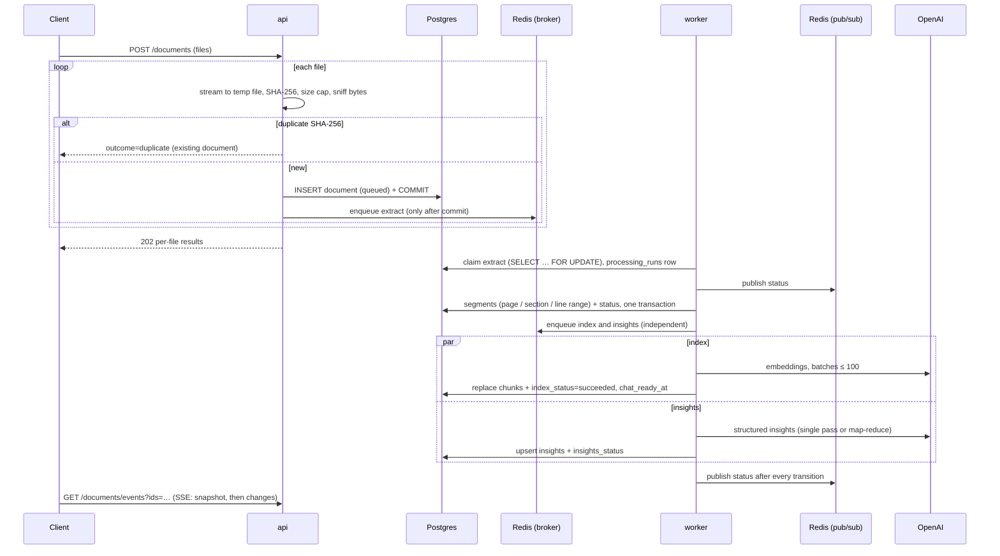

# Architecture

This describes the system as built (commit history in `git log`, decisions and fixes in
[ai-log.md](ai-log.md)). Statements about scale are design reasoning, not measurements.

## 1. Components

```
                 ┌──────────── web (Vite preview, :5173) ───────────┐
                 │ React UI · proxies /api to the api service        │
                 └───────┬────────────────────────▲──────────────────┘
              REST/JSON  │                        │ SSE: chat tokens, document status
                 ┌───────▼────────────────────────┴──────────────────┐
                 │ api: FastAPI (async, :8000)                        │
                 │ /documents /chat /metrics /health  · runs Alembic  │
                 └──┬───────────────┬──────────────────┬──────────────┘
         SQL (async)│        enqueue│ (after commit)   │ SUBSCRIBE doc:{id} · cache · spend
     ┌──────────────▼───┐   ┌───────▼────────┐   ┌─────▼──────────────────────┐
     │ PostgreSQL 17     │   │ Redis db 0     │   │ Redis db 1                 │
     │ + pgvector 0.8.7  │   │ Celery broker  │   │ caches, spend total,       │
     │ source of truth   │   │ queues ingest, │   │ worker heartbeat, pub/sub  │
     └──────────────▲───┘   │ ai             │   └─────▲──────────────────────┘
                    │        └───────┬────────┘         │ PUBLISH status events
          SQL (sync)│                │ consume          │
     ┌──────────────┴────────────────▼──────────────────┴─────┐     ┌──────────────┐
     │ worker: Celery (Linux container, prefork, concurrency 2)│────▶│ OpenAI API   │
     │ extract · index · insights                              │     │ gpt-4o-mini  │
     └──────────────┬──────────────────────────────────────────┘     │ embeddings   │
                    │ read originals                                  └──────▲───────┘
               storage volume (/data/storage, Storage interface)             │
                                                                 api: query embeddings,
                                                                 condense, answers
```

- **api** (`backend/app/main.py`): async SQLAlchemy 2 on psycopg 3; native FastAPI SSE
  (`fastapi.sse.EventSourceResponse`); pure-ASGI request-ID middleware; JSON logs.
- **worker** (`backend/app/workers/`): sync SQLAlchemy; stage logic in
  `services/pipeline.py`; tasks are thin wrappers.
- **PostgreSQL** holds every piece of state. Redis can be flushed without losing data:
  only queued tasks, caches and in-flight events are lost.
- **Storage** (`services/storage.py`): `Storage` protocol, `LocalStorage` at
  `{root}/{document_id}/original.{ext}`; an S3 implementation would only implement the protocol.

## 2. Ingestion flow



**Locators** (set at extraction, inherited by every chunk because chunks never cross a segment):
PDF `{type:"page", page}` (physical, 1-based); DOCX `{type:"section", heading, index,
paragraph_start, paragraph_end}` (no page numbers: DOCX has none reliably); Markdown
`{type:"section", heading, heading_path, index, line_start, line_end}`; TXT
`{type:"lines", start, end}`.

**Extraction failures** are permanent (`ENCRYPTED_DOCUMENT`, `CORRUPT_DOCUMENT`,
`PAGE_LIMIT_EXCEEDED`, `NO_EXTRACTABLE_TEXT`, `UNSUPPORTED_ENCODING`). Partly scanned PDFs proceed
with an `EMPTY_PAGES` warning.

## 3. Status and readiness

Each stage has its own status: `pending → running → succeeded | failed`, with `retrying` while
a transient error waits for its retry. The document's `status` is derived after every
transition, inside the same locked transaction:

| Condition | `status` |
|---|---|
| extract failed | `failed` |
| all three stages pending | `queued` |
| any stage pending / running / retrying | `processing` |
| index and insights succeeded | `ready` |
| index and insights both failed | `failed` |
| otherwise (one succeeded, one failed) | `partial` |

`chat_ready` = index succeeded. Insights are not needed to chat, and a failed index does not
hide insights. `POST /documents/{id}/reprocess` resets only failed (or chosen) stages; `extract`
re-runs everything.

## 4. Question flow

```mermaid
sequenceDiagram
    participant C as Client
    participant A as api
    participant P as Postgres
    participant K as Redis (cache)
    participant O as OpenAI
    C->>A: POST /chat/sessions/{id}/messages/stream {content}
    A->>P: resolve scope (session docs or all chat-ready docs); 409 if any not ready
    A->>P: INSERT user message + COMMIT
    Note over A: errors so far are plain JSON; streaming starts below
    opt history exists
        A->>O: condense (last 6 messages + follow-up) → standalone question
    end
    A-->>C: event: meta
    A->>K: query embedding cache (qemb:{model}:{sha256})
    alt miss
        A->>O: embed query; cache 7 days
    end
    A->>P: hybrid retrieval inside scope (vector + full text, RRF, per-doc cap)
    A->>O: answer prompt with [S1]…[Sn] sources (streamed)
    loop tokens
        A-->>C: event: token
    end
    A->>A: validate [S#] markers, map to stored chunks, set answer_status
    A->>P: assistant message + citations (snapshots) + retrieval trace + latencies
    A-->>C: event: citations, event: done
```

- The pipeline runs in its own asyncio task feeding a queue. If the client disconnects, FastAPI
  cancels the response generator, whose `finally` sets a stop flag. The pipeline stops at the
  next token and saves the partial answer with `interrupted: true`.
- `answer_status`: `answered` (≥ 1 valid citation), `not_found` (reply began with
  `[NO_ANSWER]`), `unsupported` (an answer with no valid citation), `error` (AI failure; stored so
  history stays complete).
- Every AI call (embed, condense, answer) is checked against the spend cap first and writes an
  `ai_calls` row in its own transaction.

## 5. Retrieval and the vector-index note

| Scope | Vector search | Why |
|---|---|---|
| Session documents | Exact cosine distance in a `MATERIALIZED` CTE over the scoped chunks, top 20 **per document** (`row_number()`) | With an HNSW index, `WHERE document_id IN (…)` is applied *after* the approximate search and can return too few rows. The materialised CTE keeps the planner off HNSW, so results are exact. Per-document lists stop a large document crowding a small one out before fusion |
| Whole vault (`scope_mode=all`) | HNSW (`vector_cosine_ops`) with `SET LOCAL hnsw.iterative_scan = relaxed_order`, `ef_search = 100`; re-sorted by exact distance | Iterative scans (pgvector ≥ 0.8) keep scanning when the filter removes candidates. Whether Postgres chooses HNSW is cost-based: in local tests with up to ~1,000 chunks it chose a seq scan or the `document_id` btree. **NOT VERIFIED** at large scale |

Full-text search: `plainto_tsquery('english')` with `&` replaced by `|` (any term may match;
`ts_rank_cd` rewards more matches), on a generated `tsvector` column with a GIN index, top 20
per document. Fusion: reciprocal rank fusion (k = 60), then a soft per-document cap
`max(2, ceil(top_k / n_docs))` with backfill from leftovers. Every query is restricted to the
document IDs the server resolved and to the current embedding model.

## 6. Celery reliability settings

| Setting | Value | Reason |
|---|---|---|
| `task_acks_late` / `task_reject_on_worker_lost` | true / true | A task lost with its worker is re-delivered |
| `worker_prefetch_multiplier` | 1 | Long tasks don't sit reserved behind each other |
| Redis `visibility_timeout` | 3600 s | Longer than the longest hard limit, so running tasks aren't re-delivered |
| Time limits (soft / hard) | extract 120/150 s, index 300/360 s, insights 300/360 s | Soft limit → stage fails with `STAGE_TIMEOUT` |
| Retries | transient only (OpenAI timeout / 429 / 5xx, DB connection), up to `AI_MAX_RETRIES` (3), backoff `uniform(0.5, 1) × min(60, 2^attempt)` s | `insufficient_quota`, auth and other 4xx are permanent |
| SDK retries | worker 0 (Celery retries the stage), api `AI_MAX_RETRIES` | Avoid multiplying retries |
| Queues | `ingest` (extract), `ai` (index, insights) | Scale or prioritise separately |
| Result backend | none | Postgres holds status |
| Heartbeat | key `worker:heartbeat`, TTL 30 s, refreshed every 10 s | Reported by `/health/ready` |

**Idempotency and races.** A stage is claimed with `SELECT … FOR UPDATE` and only when its status
is pending/running/retrying, so a re-delivered task for a finished stage does nothing. A run
still marked `running` from a dead worker is closed as `WORKER_LOST`. Stage data and the status
update commit together. The locked re-read uses `populate_existing=True`: index and insights
finish concurrently, and without it a stage derived the status from a stale in-session copy (a
real bug, found on the live stack; regression test in `test_pipeline.py`). Index replaces the
document's chunks (delete + insert) and insights upsert on `(document_id, prompt_version)`.

## 7. Data model

```
documents 1─* document_segments 1─* chunks (vector(1536), tsv GENERATED, HNSW + GIN + btree)
documents 1─* document_insights (unique document_id + prompt_version)
documents 1─* processing_runs
chat_sessions *─* documents (chat_session_documents)
chat_sessions 1─* messages 1─* message_citations ─→ chunks/documents (ON DELETE SET NULL; snapshot kept)
ai_calls (ledger; no foreign keys, so spend survives deletions)
```

Deletes cascade from documents to segments, chunks, insights, runs and session links. Citations
keep their document name, locator and excerpt.

## 8. Realtime: why SSE

Both realtime needs are one-way, server → browser: answer tokens and document status. The
question is a normal POST and "stop" is closing the stream. SSE runs over plain HTTP (it works
through the Vite proxy and ordinary reverse proxies) and needs no extra protocol or library. The
browser's `EventSource` only supports GET, so the UI reads the POST chat stream from the
`fetch` body (`frontend/src/api/sse.ts`); document status uses `EventSource`. WebSocket would
only be worth its complexity for a two-way need (collaboration, voice, mid-stream steering).

## 9. Caching

| Cache | Key | TTL / invalidation |
|---|---|---|
| Query embeddings | `qemb:{embedding_model}:{sha256(lowercased, whitespace-collapsed query)}` | 7 days; a new model changes the key |
| Metrics responses | `metrics:documents`, `metrics:processing:{window}` | 15 s; cleared on upload, reprocess, delete |
| Duplicate uploads | `documents.sha256` unique | until the document is deleted |
| Spend total | `ai:spend_total_usd` | 1 h; recomputed from `ai_calls` on a miss; incremented atomically after each call |

Chat answers are not cached: the same text in another session can need a different answer
(different scope and history), and reuse could cite documents outside the current scope.

## 10. Observability

JSON log lines with `request_id` and IDs, stages, durations, token counts and costs (an
allow-list in the formatter keeps document text and prompts out of logs). `X-Request-ID` on every
response. `/health` (liveness) and `/health/ready` (database + pgvector version, Redis, worker
heartbeat, AI configuration). `processing_runs` and `ai_calls` feed `/metrics/*`.
