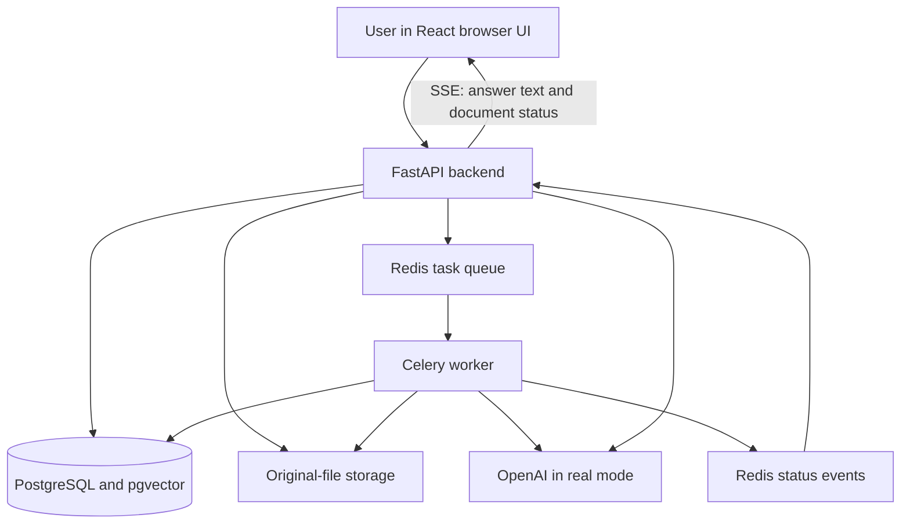

# AI Vault explained from the beginning

Prepared from this repository on 15 October 2026. Start here before rehearsing
[the video](VIDEO_WALKTHROUGH.md). You do not need to know AI terminology first.

## 1. What is this application?

AI Vault is an application where you upload documents and ask questions about their contents.
It searches for relevant passages, asks an AI model to answer using those passages, and shows
source references so you can check the answer.

Example: you upload a solar-project PDF and ask, "What is the total capital budget?"
The sample PDF says 41.5 million euros on page 3. The application can answer that question
and show a citation that opens the original passage from page 3.

It also creates document insights, lets you request a custom summary, keeps document versions,
and compares documents or versions. It is a local case-study application, with no login or
separate user accounts. The word "vault" does not establish production security.

**One sentence you can say:** "AI Vault helps someone find information in uploaded documents,
understand it, and check where the answer came from."

## 2. What problem does it solve?

Without this application, you open each document, search manually, read the relevant sections,
and combine the information yourself. This becomes awkward when the question needs facts
from several documents or you need to compare revised versions.

AI Vault supports that reading process. It does not guarantee that every answer is correct,
and it does not replace checking important facts in the original source.

Our sample documents are fictional, self-written test material. Their facts demonstrate the
application; they are not facts about a real company or project.

## 3. Learn these words first

| Word | Simple meaning | Example here |
|---|---|---|
| Frontend | The screens you click and type into | Chat, Library, Metrics |
| Backend | The program receiving requests and doing the work | FastAPI service |
| API | A defined way for programs to request work or data | Upload a file; ask a question |
| Endpoint | One address/action in the API | `POST /api/v1/documents` |
| Database | Organised, persistent application records | Documents, messages, citations |
| Background worker | A separate process doing work after the initial request | Extracting and indexing a PDF |
| Queue | A waiting list of tasks for workers | Process this newly uploaded file |
| Model | An external AI system used for a particular task | Text generation or embeddings |
| Prompt | Instructions and input sent to a text model | Answer only using these passages |
| Token | A unit of text used by models, often part of a word | Input/output size and cost accounting |
| Segment | Extracted text with an original location | One PDF page or DOCX section |
| Chunk | A smaller searchable piece of a segment | A token window inside page 3 |
| Embedding/vector | A numerical representation used to compare text meaning | Find a budget passage for a funding question |
| Retrieval | Finding passages relevant to a question | Search the stored chunks |
| Citation | A reference linking the answer to a source | `[S1]`, mapped to PDF page 3 |
| Cache | A stored result reused to avoid repeating work | Reuse an identical custom summary |
| Schema | Rules for the shape and types of data | Every requested summary topic needs a boolean verdict |
| Migration | A versioned database structure change | Add tables or fields safely |
| SSE | An HTTP stream from server to browser | Live answer text and processing updates |

An embedding is not readable source text. The application stores the original text and its
location as well, because a list of numbers cannot show the user a source passage.

## 4. What is on each screen?

| Area | What you do | What it demonstrates |
|---|---|---|
| Chat | Start a chat, attach files, ask questions, open citation chips | Document questions and source checking |
| Search entire vault | Search the latest chat-ready version of every document group | Broader scope, resolved by the server |
| Library | Find documents by filename/status, read insights, manage files | Stored documents and processing outcomes |
| Custom summary inside document detail | Choose length, tone and optional focus, then Generate | A requested summary with coverage information |
| Versions inside document detail | Upload a revision and inspect earlier versions | Preserved document history |
| What changed since v…? | Compare the current version to its predecessor | Cited changes and shared passages |
| Comparison view | Read differences and shared passages | Stored comparison results |
| Metrics | Inspect processing and AI usage | Estimated cost, timings, success/failure measurements |
| API docs at `http://localhost:8000/docs` | Inspect endpoint definitions | The frontend uses an explicit backend interface |

The API supports comparing 2–4 documents. The UI's version button is a convenient route into
a comparison with the preceding version; do not assume every API option has its own UI control.
The Library filename search is different from the meaning-based search used when answering chat.

## 5. The architecture, using an office analogy

Imagine an office with a reception desk, a work tray, processing staff and a records room.

| Component | Office analogy | Actual responsibility |
|---|---|---|
| React frontend | Customer-facing desk | Display the interface and send user requests |
| FastAPI backend | Coordinator | Validate requests, resolve scope, read/write records, orchestrate chat |
| Redis broker | Work tray | Hold queued Celery tasks |
| Celery worker | Processing staff | Extract, index and analyse documents |
| PostgreSQL | Records room | Persist the application state |
| pgvector | Meaning-search capability in the records room | Store/search embeddings inside PostgreSQL |
| Redis cache/events | Temporary notes and announcements | Cache data, count rate limits, publish status events |
| File volume | Original-file cabinet | Keep uploaded files on disk |
| OpenAI | External text/embedding service | Generate vectors and model outputs in real mode |
| Docker Compose | Office setup instructions | Start the cooperating services consistently |



Redis and PostgreSQL have different jobs. PostgreSQL is the durable record of documents,
messages and processing results. Redis handles queues, temporary caches and live notifications.
Losing Redis can lose pending work/events even though the saved database records remain.

## 6. What happens when you upload a file?

Follow one file from beginning to end:

1. The browser sends the file to the backend.
2. The backend checks size and supported file type. It examines file bytes rather than trusting
   only the filename. Renaming an executable to `.pdf` does not make it a valid document.
3. It computes a SHA-256 content fingerprint. Identical bytes identify an existing upload,
   even if the filename changes. A duplicate reuses the document without reprocessing it.
4. It saves the original file and creates a document record with an ID and queued state.
5. After committing the record, it queues extraction. The upload response can return before
   all processing finishes; HTTP 202 means accepted for processing, not finished successfully.
6. A worker reads the file and extracts text with source locations.
7. After extraction, it starts indexing and insight generation as independent tasks.
8. Each stage saves its outcome and publishes status changes. The browser receives live updates.

Default configured limits are 10 files per upload, 25 MB per file and a 300-page cap.
These are application settings, not a claim that every file at those limits has been load-tested.

Supported formats: text-based PDF, DOCX, TXT and Markdown. There is no OCR: a scanned image
does not become searchable text automatically. Encrypted/corrupt files and files with no
extractable text can fail. A partly scanned PDF may proceed with an empty-pages warning.

## 7. How do locations stay accurate?

The extractor saves text in segments. Each segment has a locator:

| Format | Saved source location |
|---|---|
| PDF | Physical PDF page, starting at 1; printed page labels can differ |
| DOCX | Section/heading and paragraph information |
| Markdown | Heading/section and line information |
| TXT | Line range |

DOCX files do not provide reliable fixed page numbers through this extractor, so the application
uses sections. The search chunks stay within their original segment. A chunk from PDF page 3
therefore carries page 3 as its location rather than spanning unrelated pages.

## 8. What is indexing? What are embeddings?

Indexing prepares extracted text for future questions.

The worker divides each segment into smaller chunks, using defaults of 800 tokens with a
100-token overlap. The overlap helps retain context around chunk boundaries. Short segments
can remain shorter than this target.

In real mode it sends chunk text to `text-embedding-3-small`, which returns numerical vectors.
The configured vectors have 1,536 dimensions. PostgreSQL stores those vectors alongside chunk
text and locators through its pgvector extension. A full-text search index is stored too.

Think of a vector as a meaning-based search coordinate. A question about "funding" may match
a passage about "capital budget" even if the wording differs. Similarity is a retrieval signal,
not a probability that an answer is correct.

**This application does not train or fine-tune a model on uploads.** It prepares searchable
records and supplies selected text to an existing model at request time.

## 9. What do the processing states mean?

| State | Meaning |
|---|---|
| Queued | Work has not started |
| Processing | At least one stage is pending, running or retrying |
| Ready | Indexing and insight generation both succeeded |
| Partial | Processing settled with one of indexing/insights successful and the other failed |
| Failed | Extraction failed, or both indexing and insights failed |

Each stage also has its own status. `chat_ready` specifically means indexing succeeded.
This matters: insights can fail while chat remains usable. If indexing fails but insights
succeed, you can still read insights, but document chat is not ready.

A loading animation alone would not capture this. These states are persisted backend data.

## 10. What happens when you ask a question?

Example: "What is the total capital budget?"

1. The frontend sends the question and chat-session ID.
2. The server resolves which documents this session may search and checks readiness.
3. It saves the user message.
4. If there is conversation history, it may rewrite the question into a standalone search
   question using the last six messages. This is question preparation, not answering.
5. It obtains the question embedding, reusing a cached embedding when available.
6. It searches the allowed document chunks by meaning and by words.
7. It combines both result rankings and selects relevant chunks, normally up to eight.
8. It labels the selected passages `[S1]`, `[S2]`, etc. and includes them in the answer prompt.
9. In real mode, `gpt-4o-mini` generates an answer with source markers, or a not-found response.
10. The server checks the citation markers and attaches saved source text/locations.
11. It saves the assistant message, citation snapshots, retrieval trace, timings and AI usage.
12. The browser displays the answer and citation chips. Click a chip to inspect the source.

The application normally sends selected retrieved passages for chat, not the entire vault.
Retrieval can miss relevant evidence. A not-found result means this attempt did not establish
an answer from supplied sources; it is not proof that the fact exists nowhere in the files.

## 11. What is RAG?

RAG means **Retrieval-Augmented Generation**:

- Retrieval: find relevant saved passages.
- Augmented: include those passages with the question and instructions.
- Generation: ask the language model to produce an answer from that input.

```text
Saved document text -> search -> relevant passages -> model -> cited answer
```

Why use it? The model's general knowledge does not establish what is in your uploaded private
document. Retrieval supplies that document evidence and avoids sending every page for every
question. RAG still has failure points: extraction, retrieval, question interpretation and
generation can each go wrong.

## 12. Why use hybrid search?

Hybrid search combines two methods:

- Vector search looks for similar meaning. It helps with different wording.
- PostgreSQL full-text search looks for query words/normalised terms. It helps with distinctive
  names and terms, although it is not a guarantee of exact identifier matching.

Reciprocal Rank Fusion, or RRF, combines their ranked lists. In this implementation, a result
receives contributions of `1 / (60 + rank)` from each list where it appears. A result ranking
well in both lists can rise in the combined list. This avoids directly comparing two unrelated
raw scoring scales.

For explicitly selected documents, vector search uses an exact search over the scoped chunks
and gathers candidates per document. For whole-vault searches, it uses the HNSW vector index
with iterative scanning. HNSW is an approximate nearest-neighbour search structure; it helps
avoid comparing every vector but does not establish measured performance at large scale here.
A soft per-document cap helps prevent one document dominating a multi-document answer;
remaining spaces can be filled from other candidates.

## 13. What does citation validation actually prove?

`[S1]` means source 1 among the passages retrieved for this answer. It does not mean page 1.
The server maps it to the actual document and saved page/section/line locator.

It removes unknown source markers and takes the displayed excerpt from stored text rather
than trusting the model to reproduce a quote. An answer without valid source markers is
marked unsupported. A model reply beginning with `[NO_ANSWER]` becomes a not-found result.

**A valid citation proves that the reference maps to a supplied source. It does not prove that
every claim correctly follows from that source.** Read the passage to assess that relationship.
The model is instructed to cite factual sentences; the marker validator is not a full
sentence-by-sentence truth checker. During streaming, displayed text is provisional until
final citation processing completes.

## 14. How do follow-up questions work?

Question 1: "What is the total capital budget?"
Answer: "41.5 million euros."
Question 2: "When was it approved?"

The second question depends on the conversation. The condenser rewrites it into something
like "When was the total capital budget approved?" for retrieval. The UI can show the search
rewrite under the answer. The active prompt is `chat.condense.v3`.

Why v3? V2 sometimes attached an ambiguous "its" to the wrong noun. For example, after a
budget conversation it turned a capacity question into a question about a budget's capacity.
V3 tells the model to preserve ambiguous questions when the conversation does not establish
one clear referent. It passed the known ambiguity case twice in a small real evaluation.
This is evidence for that case, not proof that all pronouns are resolved correctly.

## 15. What are insights, custom summaries and comparisons?

They are different operations:

| Operation | When it runs | What it provides |
|---|---|---|
| Automatic insights | Background processing after extraction | Short/detailed summary, cited key points, entities, topics/category/tags, sentiment, suggested questions |
| Custom summary | When requested in the document panel/API | Length/tone/focus-specific summary, points, coverage and missing-focus information |
| Comparison | When requested for 2–4 documents/versions | Cited differences and retained shared passages |

For long automatic-insight input, map-reduce divides text into groups, makes notes for each
group, and combines the notes. The default single-pass threshold is 60,000 input tokens.
The broader test forced this path with a lower threshold; it did not establish quality for
every maximum-size production input. Automatic insights retain their own older prompts and
known quality limitations; summary v5 fixes do not automatically apply to them.

Custom summaries support short/medium/long and neutral/executive/technical/plain tones.
In active `summary.custom.v5`, the server assigns an ID to each requested focus topic. The
model must return an independent addressed/not-addressed boolean for every ID, plus cited
points with literal supporting quotes. The server checks evidence and builds the summary
with missing-topic and partial-input notices.

Example: focus "budget and risks" on the original solar brief. The real v5 check returned
budget addressed, risks not addressed, and "The document does not address risks."
Earlier versions had invented risks or merged the topics and lost that notice.
V5 fixes the output representation; the model can still make a wrong factual judgement.
Its topic splitting is literal: "research and development" becomes two topics.

Active `compare.v2` retains shared sentences only when the same sentence occurs in at least
two cited documents, allowing case/whitespace normalisation. The UI calls these "Shared
passages". This conservative rule rejects generic similarities but can omit a true shared
fact expressed in different words. Model-authored differences still need review.

Custom summaries have a 40,000-token default input cap. Comparisons share that cap across
their documents. Longer input uses selected parts and reports incomplete coverage.
"Not found in the selected parts" is weaker than "not in the entire document".
These on-demand operations run through the API rather than the background ingestion queue.

## 16. How do versions work?

A new version gets its own document record, original file, extracted text, chunks and insights.
It belongs to the same version group as its predecessor. Database constraints and locking
protect the rule that a group has only one latest version.

Example: the original brief has 41.5 million euros; version 2 has 44.0 million euros.
Both remain available. Whole-vault chat uses the latest indexed/ready-for-chat version rows
that satisfy its scope query. Importantly, when a new version becomes latest but is still
processing, the old version is no longer selected by whole-vault scope; that group can be
temporarily absent. A chat explicitly attached to version 1 keeps version 1.
Do not interpret different old-chat and whole-vault answers as necessarily a model error:
first check which version each session searches.

## 17. How do live text and Stop work?

SSE sends events from the server to the browser over HTTP. The question itself is a normal
request. The response stream carries metadata, text pieces, citations and completion/errors.
Document status also uses SSE; the worker publishes changes through Redis to the API.

This fits one-way updates. WebSockets would be useful for a persistent two-way feature such
as interactive collaboration; that is not needed for the current text/status streams.

Stop closes the answer stream. The application saves the partial answer as interrupted.
It is not a promise that the external provider stops processing instantly or charges nothing
for work already done.

## 18. Where is everything stored?

| Storage | Saved information |
|---|---|
| Original-file Docker volume | Original uploaded files |
| `documents` | File metadata, versions, statuses, stage results |
| `document_segments` | Extracted text with source locations |
| `chunks` | Search text, locators, embeddings, full-text index data |
| `document_insights` / `document_summaries` | Automatic insights and custom summaries with versions |
| `document_comparisons` | Saved comparisons |
| `chat_sessions` and session-document links | Conversation identity and selected scope |
| `messages` / `message_citations` | Questions, answers and source snapshots |
| `processing_runs` | Stage attempts, timings and outcomes |
| `ai_calls` | Model, purpose, tokens, estimated cost and outcome |
| Redis | Queued tasks, cache entries, counters, heartbeat and live events |

Deleting a document removes its dependent processing/search/analysis data and comparisons
containing it. Past message citations retain their saved excerpt/location snapshot, even
when their original document has been deleted. That snapshot is not access to the deleted
original file. The AI ledger survives deletion so cost history is not erased.

## 19. What leaves the computer in real mode?

The interface, database and file volume run locally with Docker. AI processing is external
when `AI_PROVIDER=openai`:

- Chunk text is sent for document embeddings.
- Extracted text or grouped text is sent for automatic insights.
- Questions are sent for embeddings; follow-up rewriting includes recent conversation context.
- Retrieved source passages and the question are sent for answers.
- Custom summaries and comparisons send their selected document text.

Therefore "runs locally" does not mean "all document content stays offline". This guide does
not establish the provider's current retention terms. Use the supplied fictional samples for
the demo. Do not expose `.env`, API keys or unrelated private files in the recording.

## 20. What controls cost and repeated work?

The application records model calls and estimated token-based cost. It checks estimated
accumulated spend before calls; the default configured limit is $0.50. This is an application
guard, not a provider billing limit or an exact prepaid reservation. Calls already in flight
can overshoot the threshold. Token costs here are application estimates, not invoices.

Some repeated work is avoided:

- Identical file bytes reuse an existing document.
- Query embeddings can be reused from Redis for seven days.
- Identical custom-summary options reuse a stored result for the same document/model/prompt version.
- Comparisons reuse a stored result for the same documents/focus/model/prompt version.
- Metrics are cached briefly, normally 15 seconds.

Chat answers themselves are not cached. The same wording can need different evidence in
another session or version scope. A cached embedding also does not make a new chat answer free.
One user action can trigger multiple model calls; an upload includes indexing and insights,
and a follow-up can include rewriting, a query embedding and answer generation.

Default rate limits allow 20 AI requests and 30 upload-group requests per minute per client IP.
They return HTTP 429 and a retry time. These limits control request bursts, not total dollars.
They use fixed windows and fail open if Redis is unavailable. Behind the current proxy setup,
clients can share one observed address and therefore one limit.

## 21. What happens when something fails?

The backend returns consistent error objects with a code, message, details and request ID.
Request IDs also help match errors to structured logs. Logs are designed to omit document
text and prompts.

Workers retry transient failures such as timeouts and temporary provider/server problems.
Invalid keys, exhausted provider quota, corrupt documents and similar permanent errors need
correction rather than endless retries. Stage time limits prevent tasks running indefinitely.

Stage locking and idempotent writes reduce duplicate processing from repeated task delivery.
Idempotent means repeated execution does not create a second inconsistent copy of the saved
result. This does not guarantee that a model request can never be repeated or billed again
if a worker dies at an unfortunate point.

Reprocess can retry failed stages. Readiness checks database, Redis, worker heartbeat and AI
configuration. A healthy configuration check does not prove that the next paid API call will
succeed or that its answer will be correct.

## 22. Why this technology stack?

These are engineering reasons visible in the design, not claims about choices you personally made.

| Technology | Role and reason |
|---|---|
| Python / FastAPI | Typed request handling, async API work, automatic OpenAPI documentation |
| Pydantic | Validate request/response shapes and strict model-output schemas |
| SQLAlchemy / psycopg | Work with PostgreSQL from API and worker code |
| Alembic | Track database structure changes |
| PostgreSQL + pgvector | Keep ordinary records, source text and vectors in one database |
| Celery + Redis | Move document processing out of the upload request |
| pypdf / python-docx | Extract document text without claiming OCR support |
| LangChain OpenAI integration | Connect model calls and structured-output generation |
| React / TypeScript | Build interactive screens with typed frontend code |
| TanStack Query | Fetch/cache server data in the frontend |
| Tailwind | Style the UI |
| Docker Compose | Run the database, queue, API, worker and frontend together |
| pytest / Ruff | Automated backend checks and Python formatting/linting |

LangChain is not the database, the model or the retrieval algorithm. pgvector is a PostgreSQL
extension, not a separate hosted database in this application.

## 23. Where should I look in the code?

Paths below are relative to the repository root. Read in this order if you want to trace work:

| File/directory | What to learn |
|---|---|
| `frontend/src/components/ChatView.tsx` | Chat screen and streaming interaction |
| `frontend/src/components/LibraryView.tsx` | Documents, insights, custom summary and versions UI |
| `frontend/src/components/ComparisonView.tsx` | Differences and shared passages |
| `frontend/src/components/MetricsView.tsx` | Monitoring screen |
| `backend/app/main.py` | API application setup |
| `backend/app/api/documents.py` | Document endpoints |
| `backend/app/services/upload.py` | File validation, duplicates and storage |
| `backend/app/services/pipeline.py`, `backend/app/workers/` | Stage orchestration and queued tasks |
| `backend/app/services/retrieval.py` | Hybrid scoped search |
| `backend/app/services/chat.py` | Question-to-answer orchestration |
| `backend/app/services/citations.py` | Marker validation and original excerpts |
| `backend/app/services/insights.py` | Automatic analysis and map-reduce |
| `backend/app/services/summaries.py` | Custom summary evidence/topic handling |
| `backend/app/services/comparisons.py` | Comparisons and shared-passage validation |
| `backend/app/prompts/` | Versioned model instructions |
| `backend/app/models/`, database migrations | Saved records and constraints |
| `backend/app/core/config.py` | Defaults and configuration |
| `backend/tests/` | Fake-mode and separately gated real-model checks |

You do not need to memorise every function to present the project. Be able to trace one upload
and one question, then explain why source text, locations and scope are preserved.

## 24. What has actually been tested?

Recorded results as of 15 October 2026, not a new test run performed for this guide:

| Evidence | What it supports | What it does not establish |
|---|---|---|
| Latest full fake-mode backend suite: 152 passed, 3 live tests deselected | Application logic with deterministic model doubles and real test infrastructure | General model answer quality |
| Post-bonus clean-clone check: 145 passed at that earlier commit, plus build/lint/walkthrough | Reproducibility at that recorded revision | A fresh clean-clone check of every later change |
| Initial 10-question real smoke test: 10/10 expected outcomes | Those seven cited and three not-found cases | 100% accuracy on arbitrary documents |
| Broader real run: 42 calls | Specific chat, ambiguity, long-input and scope cases; also exposed summary/comparison failures | A universal pass result or security guarantee |
| Targeted five-call run | Specific comparison/summary checks; exposed merged summary topics | That summary v4 was fully correct |
| Latest two-call v5 run: $0.000504 estimated | Known budget/risks case and a no-focus control, once each | General stability, held-out quality or v5 partial-input behaviour |

Retained main-demo and evaluation ledgers total 92 real calls / $0.01672337 estimated.
This is the sum of documented retained snapshots, not an invoice or all historical usage.
See [EVALUATION.md](EVALUATION.md) for individual results and failures.

## 25. What should I say about limitations and future work?

Current limits include no login/multi-tenant isolation, no OCR, local file storage,
English-oriented full-text search, limited real evaluation, possible retrieval/generation
errors, and incomplete custom-summary/comparison input for long documents. Large-scale
performance and general resistance to malicious document instructions are not established.

Possible future work: authentication and ownership checks, production secret/network controls,
object storage, OCR, broader real evaluations, better semantic evidence checks and measured
load tests. Describe these as proposed improvements, not implemented features.

## 26. Questions a reviewer might ask

**Is this just sending the entire PDF to a chatbot?**
For chat it extracts, chunks, indexes and retrieves source passages first. Automatic insights
and on-demand analysis have separate whole-text/grouped/selected-input paths.

**Is the AI trained on the uploaded documents?**
No training or fine-tuning happens here. Stored vectors support retrieval; existing models
receive selected text when a request is made.

**Why not just use keyword search?**
Keyword and meaning searches each have strengths. Combining their rankings can find relevant
passages with different wording while keeping useful word matches.

**Why background processing?**
Extraction, embedding and insights can take time. Upload acceptance and saved stage states let
the UI stay responsive and expose failures without holding one long upload request open.

**Why keep original text when vectors already exist?**
Vectors help locate text. Original text supports the answer and source viewer.

**How do you prevent hallucinations?**
The design reduces risk through scoped retrieval, source-only prompts, citation checks,
not-found handling and evidence validation in custom analysis. It does not eliminate them.

**Can one chat read another chat's selected documents?**
The server resolves each session's document scope and filters retrieval accordingly. That
is document scoping in a single-user demo, not authentication or tenant isolation.

**What was a meaningful bug and how was it corrected?**
Real summary checks exposed invented risks, then missing/merged topic gaps. V5 requires a
separate server-owned verdict field per requested topic and server-rendered gap notices.
The latest two real cases passed. General verdict accuracy still needs broader evaluation.

**What did you personally build or review?**
Use [AI_USAGE.md](../AI_USAGE.md) and the change log. The implementation was AI-assisted with
Claude Code and continued with OpenAI Codex. Only claim personal decisions/reviews you actually
made. Learning the design now is useful; pretending you already wrote or reviewed it is not.

## 27. How to practise before recording

1. Explain the product in one sentence without using the word RAG.
2. Trace upload -> extraction -> indexing/insights -> saved status.
3. Trace question -> scoped hybrid search -> sources -> answer -> checked citation.
4. Explain one citation by opening the original passage.
5. Explain why not-found can be the correct outcome.
6. Explain automatic insights versus a custom summary.
7. Explain latest-version scope versus a chat attached to an old version.
8. State one verified result and one limitation without overstating either.

If you cannot yet explain a term, use its simple meaning from section 3. A clear explanation
of the actual behaviour is more useful than reciting library names.
